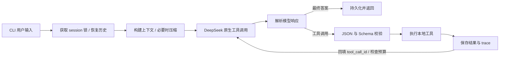

# Loomora · 最小自研 Agent

基于 Python 和真实 DeepSeek Chat Completions API 的命令行 Agent。核心循环、工具注册、参数校验、输出解析、session 持久化和上下文管理均自行实现；没有使用 LangGraph、LangChain、OpenHands 等 Agent 框架。

实现三个同步工具、独立会话、持续追问、基础压缩、执行日志和测试。没有 Web 服务，交付的是可运行源码。

## 运行

需要 Python 3.11+ 和 uv。克隆仓库后安装依赖并创建本地配置：

```powershell
git clone https://github.com/zhanpeng911-droid/Loomora.git
cd Loomora
uv sync --frozen
Copy-Item .env.example .env
```

在本地 `.env` 中填写 `DEEPSEEK_API_KEY`，不要提交或分享真实密钥：

```dotenv
DEEPSEEK_API_KEY=你的真实密钥
DEEPSEEK_BASE_URL=https://api.deepseek.com
DEEPSEEK_MODEL=deepseek-flash
LOOMORA_DATA_DIR=.loomora
```

默认模型名称来自 2026-11-04 核对的 [DeepSeek 官方工具调用示例](https://api-docs.deepseek.com/guides/tool_calls/)，可用环境变量调整为账号实际支持的模型。固定 `thinking.type=disabled`，适合本题的轻量工具循环。该适配器针对 DeepSeek；其他厂商的兼容性没有实测。

```powershell
uv run loomora --user alice --session window1
# 或执行单条消息后退出
uv run loomora --user alice --session window1 --message "用 calculator 算 17*23，再记一个待办：整理 Agent 笔记" --trace
```

没有 uv 时也可使用 `python -m pip install -e .`，然后 `python -m loomora`。依赖锁定与开发测试以 `uv.lock` 为准。

交互命令：`/history` 查看本会话对话、`/todos` 查看真实待办状态、`/trace` 查看最近执行事件、`/exit` 退出。命令本身不调用模型。

### 两个窗口与追问

分别打开两个终端，使用相同数据目录、相同用户、不同 session：

```powershell
# 窗口一
uv run loomora --user alice --session window1
# 窗口二
uv run loomora --user alice --session window2
```

窗口一输入“记一个待办：带伞”，窗口二输入“记一个待办：写周报”。两个窗口分别用 `/todos` 核对；然后在窗口一输入“把刚才那个标记完成”。退出并重新使用原来的 `--user`、`--session` 即可续聊。示例是验收步骤，不是预先伪造的模型输出。

纯对话追问可使用“把项目名称记为小舟”→“刚才的项目叫什么”。带工具追问可使用“计算 17*23”→“把刚才的结果再乘 2”。是否调用工具由模型依据 Schema 和上下文决定，没有按关键词写死路由。

## 系统设计



| 文件 | 职责 |
| --- | --- |
| `loomora/runtime.py` | 自研循环、每次请求最大 8 次模型决策、中断恢复 |
| `loomora/llm.py` | HTTP 接入、超时与有限重试、输出结构解析 |
| `loomora/tools.py` | 工具注册、Schema 校验和三个工具 |
| `loomora/store.py` | SQLite 历史、摘要、待办、trace；跨进程会话锁 |
| `loomora/context.py` | 请求预算、完整交互保留、旧历史压缩 |
| `loomora/cli.py` | 本地配置、交互和单次执行入口 |

`httpx` 只负责 HTTP，`jsonschema` 只负责参数验证，`filelock` 只负责文件锁，`python-dotenv` 只负责读取本地配置。这些依赖不负责 Agent 编排。

### 工具与输出解析

| 工具 | 功能 | 边界 |
| --- | --- | --- |
| `calculator` | `+ - * / // % **` 和括号 | AST 白名单，无 `eval`；限制长度、复杂度和数值 |
| `search` | 检索内置 Agent、session、todo 示例资料 | **mock**，结果明确标识；不提供实时搜索或天气 |
| `todo` | `add`、`list`、`complete` | 按 user/session 隔离；同名未完成项去重；最多 100 项 |

每个工具包含名称、描述、JSON Schema 和处理函数；新增工具只需注册 `Tool`。模型返回的 `function.arguments` 会经过严格 JSON 解析及 Schema 校验，不能任意运行代码。错误以 `{ok:false,error:{code,message}}` 返回模型，允许模型在剩余轮数中纠正。

todo 的 list 分页返回 `items` 和 `next_cursor`，默认每页最多 5 项；有后续页时将游标传给 `after_id`，避免长列表被截断后后面的项目永远不可见。

输出解析区分最终答案 `content`、结构化 `tool_calls` 和可选的 `reasoning_content`。不依靠正则从自然语言里猜工具调用，也不要求模型披露长篇思考。默认非思考模式；如果接口仍提供 reasoning 字段，解析器保留它用于协议回传，CLI 和 trace 不展示它，摘要不使用它。[DeepSeek 思考字段回传要求](https://api-docs.deepseek.com/guides/thinking_mode/)

一次模型响应可以发起多个调用，本实现按返回顺序串行执行。每个调用都用原 `tool_call_id` 回填结果。模型响应截断、缺少调用 ID、重复 ID、空答案等异常会停止当前请求，不执行不完整调用。

### Session 与持久化

会话键为 `(user_id, session_id)`，历史、摘要、todo 和 trace 都按此键读写。不同窗口不会隐式共享用户级记忆。SQLite 存在 `.loomora/agent.sqlite3`，重启后继续使用；该目录和 `.env` 已加入 `.gitignore`。

文件锁覆盖一次用户请求，SQLite 事务只覆盖短暂读写。同一会话同时提交会收到 busy 错误，不修改历史；不同会话可并行调用模型。锁由操作系统管理，进程退出后释放。

调用计划先落库，每项工具结果执行后再落库。若进程在中间退出，下次进入该会话时为未完成调用补齐“结果未知”，并保留已完成结果；不会自动重放可能已经生效的修改。todo 去重只解决同名未完成项的常见重复，不声称提供所有工具的 exactly-once 保证。

`--user` 是本地数据命名空间，**不是登录认证**；本项目不作为面向多租户的网络服务部署。历史以明文存在本地，真实运行时选中的上下文会发送给配置的 DeepSeek 服务。

## Memory 的召回时机与放置方式

这里的 memory 是会话记忆与结构化 todo，不引入向量库或长期用户画像。

1. **每次用户输入时**，先读取该会话已有摘要及摘要水位之后的完整交互。
2. 活动上下文按“固定 system → 标记为历史资料的摘要 → 近期完整交互 → 当前输入”构建；工具 Schema 独立随请求发送。
3. **执行工具后**，将调用和真实结果一起放入当前交互，下一次模型决策立即可见。工具结果与历史摘要是资料，不是系统指令。
4. todo 是数据库里的事实；当用户问待办或用“刚才那条”等指代修改时，模型通过 `todo.list` 召回真实 ID 和状态。不会每轮把所有待办塞入 prompt。

默认对消息与工具 Schema 的序列化 UTF-8 总量设 32,000 字节预算，这是一种保守的体积控制，**不是厂商精确 token 计数**；另设 `max_tokens=2048` 限制模型输出。每次模型决策前再次检查预算。

历史超预算时，最多额外调用一次模型生成最多 2,000 字符的语义摘要，优先保留目标、约束、更正、已确认事实和未完成事项；尽量保留最近 4 个完整交互，空间不足再减少。压缩不会拆开工具调用与结果，也不会删除 SQLite 原始记录。摘要请求自身受预算约束；摘要失败采用明确标识的有损摘录。

工具回填可能使同一请求再次超预算。此时先缩短本次注入的摘要，不够时再将旧的完整交互转为标明“本轮压缩预算受限”的本地摘录，重建上下文后继续执行。这个路径不再调用摘要模型，避免压缩重试增加 API 成本；原始历史和当前完整工具协议保持不变。

摘要可能遗漏或误述旧细节，过大的历史需要截取摘要输入；不能承诺任意 200 轮后逐字回忆全部内容。当前未实现自动检索已压缩原文，用户可用 `/history` 核对并重新提供细节。结构化 todo 不受摘要压缩影响。单次用户输入或当前工具链仍放不下时明确停止并保留进度，不偷偷截断当前请求。

## 异常与 trace

每个请求最多 8 次主循环决策（`--max-steps` 可调整，范围 1–32）；压缩最多增加 1 次摘要请求。单次 HTTP 的超时默认 30 秒，网络错误、429、5xx 最多重试 2 次；配置错误和其他 4xx 不重试。重试发生在模型请求层，不会重放本地工具。

轮次耗尽、超预算、模型故障和 Ctrl+C 都会产生明确的非成功结果；已完成的工具操作保留。当前工具全部是有边界的本地同步操作，没有后台异步工具或调度器。

SQLite `traces` 表记录 run ID、步骤、工具名、调用 ID、耗时、成功状态和错误类型。`--trace` 或 `/trace` 可以查看；不记录 API key、工具参数、完整输出或思考正文。原始对话和工具结果在 `turns` 表，用于恢复会话。

## 测试与验收

```powershell
uv run pytest -q
uv run ruff check .
uv run ruff format --check .
```

自动测试使用脚本化模型和 HTTP MockTransport，以确定性方式检查真实 runtime、SQLite 和工具的行为；模拟只在测试中存在。正常 CLI 必须配置真实 DeepSeek，不会回退到假模型。

真实 API 验收需在本地配置密钥并显式开启，会消耗 API 额度：

```powershell
$env:RUN_LIVE_TESTS = "1"
uv run pytest -q -m live
Remove-Item Env:RUN_LIVE_TESTS
```

两个 live 用例分别验证三个工具的成功结果、追问完成待办及第二会话隔离，以及纯对话重启追问和真实摘要后的事实保留。压缩用例加入明确标注的合成历史来触发预算阈值，不代表执行过数百次真实模型聊天。

2026-11-04 已使用真实 DeepSeek API 运行上述两个小型用例，结果 **2 passed**。默认测试命令仍跳过 live 用例，以免每次离线回归都消耗 API 额度；单次通过也不代表所有输入的工具选择和摘要质量都有保证。更多验收步骤见 [docs/acceptance.md](docs/acceptance.md)。

## 题目材料

- [架构题答案](docs/architecture-answers.md)：五个模块分别选第 2、1、1、2、1 题。
- [AI Prompt 与问题解决记录](docs/ai-development-log.md)：记录辅助开发过程、取舍和验证边界。
- [验收清单](docs/acceptance.md)：要求与实现、测试的对应关系。

源码仓库：[zhanpeng911-droid/Loomora](https://github.com/zhanpeng911-droid/Loomora)。`.env`、`.loomora` 和本地数据库不纳入版本控制。
